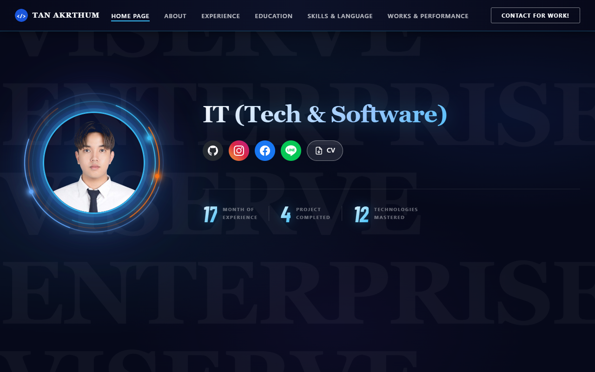
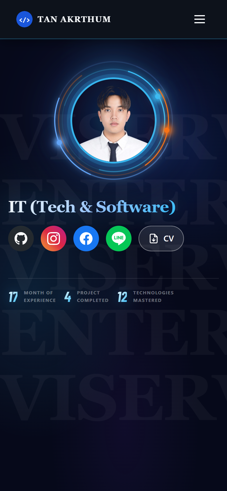

<div align="center">


<br>

<a href="https://web-tan-portfolio.vercel.app"></a>


</div>

## Overview

เว็บไซต์แฟ้มผลงานส่วนบุคคล นำเสนอประวัติการทำงาน การศึกษา ทักษะด้านเทคโนโลยีและภาษา รวมถึงผลงานและใบประกาศนียบัตร ในรูปแบบหน้าเดียว (single page) รองรับทั้งคอมพิวเตอร์และโทรศัพท์มือถือ

*A single-page personal portfolio presenting professional experience, education, technical and language skills, projects and certificates.*

<table>
<tr>
<td width="72%"></td>
<td width="28%"></td>
</tr>
<tr><td align="center"><sub>หน้าจอคอมพิวเตอร์</sub></td><td align="center"><sub>หน้าจอโทรศัพท์มือถือ</sub></td></tr>
</table>

## Sections

| Section | Content |
|---|---|
| Home | บทนำ รูปโปรไฟล์ และสถิติประสบการณ์ |
| About | ข้อมูลส่วนตัวและเป้าหมายในสายอาชีพ |
| Experience | ประวัติการทำงาน |
| Education | ประวัติการศึกษา |
| Skills & Language | ทักษะด้านเทคโนโลยีและภาษา |
| Works & Performance | ผลงานและโปรเจกต์ พร้อมรายละเอียดแต่ละรายการ |
| Gallery | ใบประกาศนียบัตรและภาพผลงาน |
| Contact | ช่องทางติดต่อและเอกสาร CV (PDF) |

## Selected Projects

| Project | Description |
|---|---|
| [THANDER Company](https://thander-company-ai-campus.vercel.app/) | สำนักงานใหญ่ 3D โทนน้ำเงิน 4 ชั้น 11 ฝ่าย 64 บทบาท ปรับหน้าแรกให้ปุ่ม/ชื่อชั้นไม่ล้นหรือซ้อนกันบนจอเล็ก มี favicon บริษัทและไอคอนมือถือ พร้อม [Workflow และหน้าที่ทุกฝ่าย](https://thander-company-ai-campus.vercel.app/workflow.html#departmentDirectory), ตัวอักษรใหญ่ คอนทราสต์ชัด การ์ดแยกสีแต่ละฝ่าย ไดอะแกรม SVG และพื้นที่ CEO ส่วนตัว พร้อม [ตัวอย่างสั่งแผนคอนเทนต์ 7 วัน](https://thander-company-ai-campus.vercel.app/workflow.html#practiceLab) สร้างไฟล์ CSV/Markdown ในเบราว์เซอร์และตรวจรับตัวอย่าง พร้อมระบบ CEO เชื่อม Gemini รับไฟล์แผนคอนเทนต์ 7 วัน CSV/Markdown จริงสำเร็จแล้ว พร้อมไฟล์ภาษาไทยแบบ UTF-8 BOM สำหรับ Excel (Free Tier ต้องใช้โปรเจกต์ที่ไม่เปิด Billing; โควต้าขึ้นกับบัญชี) (Private source) |
| [Thander Usage](https://thander-usage.vercel.app/) | Windows desktop robot companion for Claude/Codex usage, articulated greeting and interactive web demo. [Source](https://github.com/tanakrthum254614-max/thander-usage) |
| [Gold Signal](https://github.com/tanakrthum254614-max/gold-signal) | แพลตฟอร์มสัญญาณการซื้อขายทองคำแบบเรียลไทม์ พร้อมผลทดสอบย้อนหลังและการเปิดเผยผลการซื้อขายจริง |
| [IT Asset Tracker](https://github.com/tanakrthum254614-max/it-asset-tracker) | ระบบทะเบียนครุภัณฑ์ไอทีพร้อมป้าย QR และการติดตามการรับประกัน |
| [IT Expiry Alert](https://github.com/tanakrthum254614-max/it-expiry-alert) | ระบบแจ้งเตือนก่อนใบรับรอง SSL โดเมน ลิขสิทธิ์ และสัญญาหมดอายุ |
| [IT Runbook](https://github.com/tanakrthum254614-max/it-runbook) | ศูนย์รวมขั้นตอนแก้ไขปัญหาไอทีเบื้องต้นสำหรับผู้ใช้งาน |

## Project Structure

```
├── index.html        หน้าเว็บหลัก (HTML · CSS · JavaScript)
├── Portfolio.html    สำเนาหน้าเว็บหลัก (รักษาให้ตรงกัน)
├── api/              Serverless functions สำหรับแกลเลอรี
├── data/ · images/   ข้อมูลและรูปภาพผลงาน / ใบประกาศนียบัตร
└── TAN_AKRTHUM.pdf   เอกสาร CV
```

## Development

```bash
npx serve .      # หรือเปิดไฟล์ index.html ในเบราว์เซอร์โดยตรง
```

การ push ไปยัง branch `master` จะ deploy ไปยัง Vercel โดยอัตโนมัติ

---

<div align="center"><sub>© 2569 Tan Akrthum · Bangkok, Thailand</sub></div>

### THANDER hosting update · 20 October 2026

The THANDER campus project was transferred to Vercel team `thander2` using the official claim flow. The original website URL remains unchanged; CEO sign-in, five existing private jobs and both generated files were verified after transfer without additional AI generation. Private storage was also migrated to `thander2`: all five source objects (20,977 bytes) were copied with matching SHA-256 hashes, and production now uses the new store credential. The original source store is retained as a rollback copy. The private GitHub repository was reconnected after the claim. This update does not publish private deliverables or credentials. `index.html` and `Portfolio.html` remain identical.
